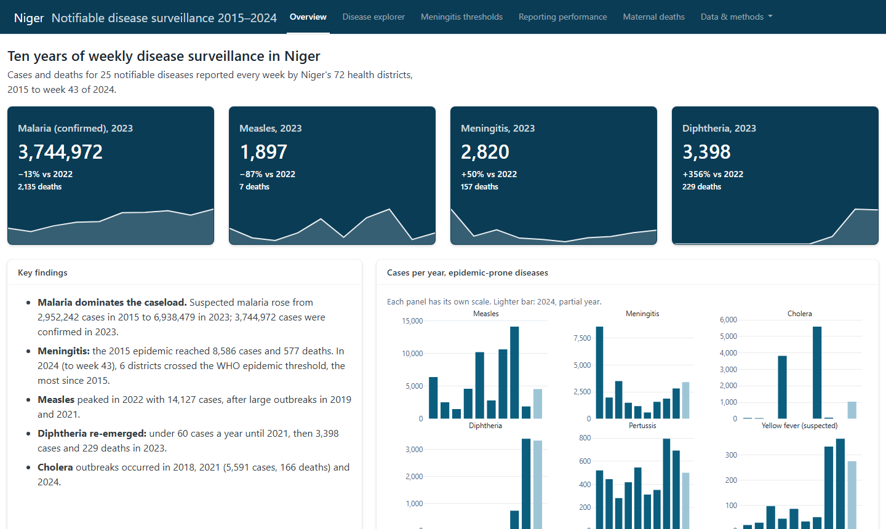
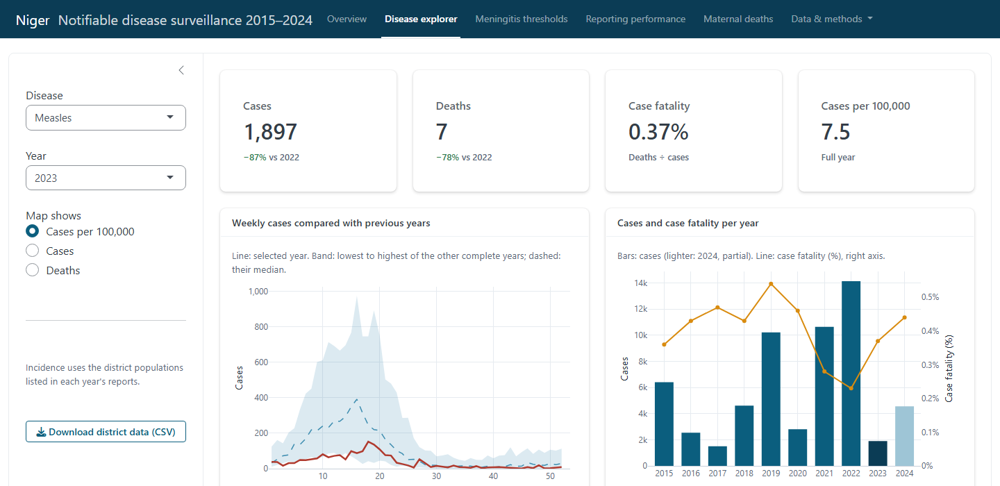
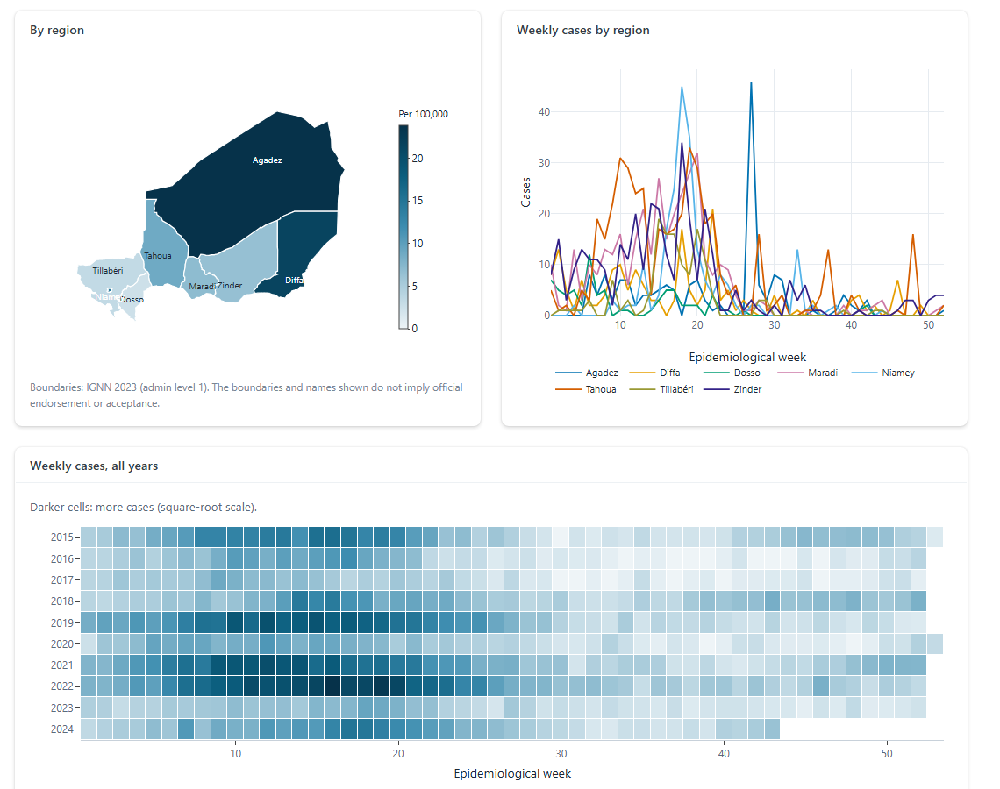
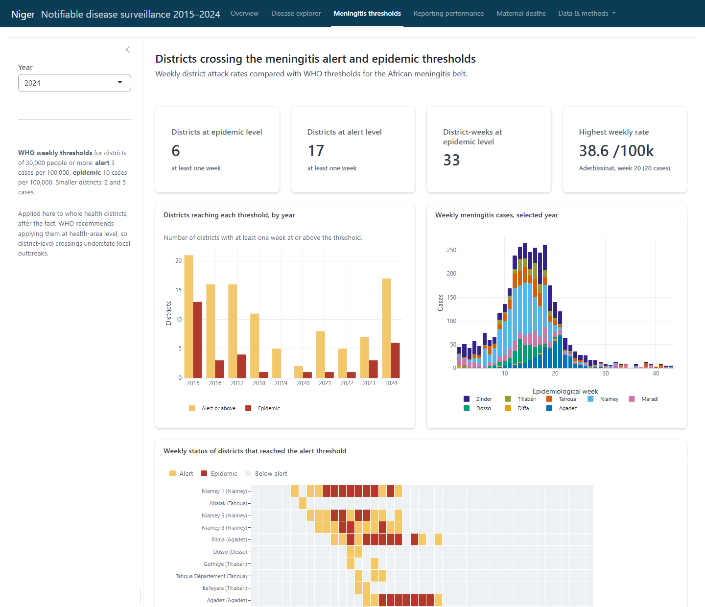
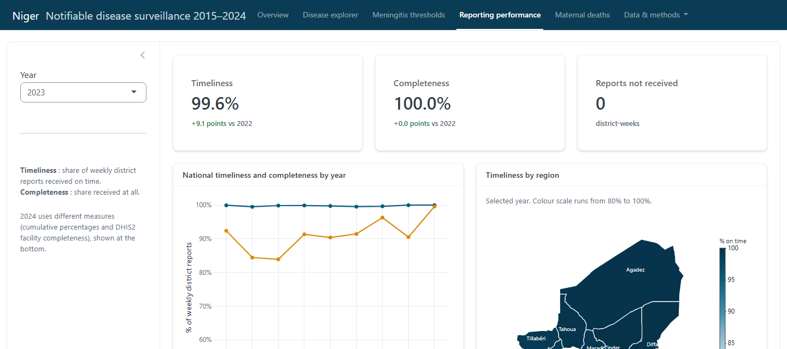

# Niger notifiable disease surveillance, 2015–2024


Ten years of Niger's weekly notifiable disease reports (*Maladies à Déclaration Obligatoire*, IDSR), cleaned into tidy tables, cross-checked against every total in the source files, and presented in an R Shiny dashboard.



## Contents

- [Quick start](#quick-start)
- [The dashboard](#the-dashboard)
- [Data](#data)
- [Repository structure](#repository-structure)
- [Rebuilding the data](#rebuilding-the-data)
- [Quality checks](#quality-checks)
- [Caveats](#caveats)
- [Deployment](#deployment)

## Quick start

**Windows:** install [Miniforge](https://conda-forge.org/download/), then double-click **`run_app.bat`**. The first run creates the `mdo-niger` environment (a few minutes); after that the dashboard opens in your browser in 10–20 seconds. Keep the black window open while you use it.

**Any system:**

```bash
conda env create -f environment.yml
conda activate mdo-niger
Rscript -e "shiny::runApp('app', launch.browser = TRUE)"
```

## The dashboard

| Tab | What it answers |
|---|---|
| **Overview** | Which diseases matter most, and how have they changed? Headline figures, key findings, trends for epidemic-prone diseases, and a table of all 25 diseases |
| **Disease explorer** | For any disease and year: is this year unusual? Weekly cases against the range of previous years, yearly cases and case fatality, region map, weekly curves by region, district ranking |
| **Meningitis thresholds** | Which districts crossed the WHO alert (3/100,000/week) or epidemic (10/100,000/week) threshold, and when? |
| **Reporting performance** | How reliably do districts report? Timeliness and completeness, 2015–2023, and 2024 DHIS2 completeness |
| **Maternal deaths** | Maternal deaths notified and investigated, 2015–2021 |
| **Data & methods** | DHIS2 2024 compared with the weekly reports; what each source file contributes; every cross-check; definitions and caveats |

Every chart exports a PNG (camera icon), every table exports CSV or Excel, and a link can open a given tab, e.g. `?tab=Meningitis%20thresholds`.

<table>
  <tr>
    <td width="50%"></td>
    <td width="50%"></td>
  </tr>
  <tr>
    <td><b>Disease explorer.</b> Measles in 2023 against the range of 2015–2022.</td>
    <td><b>By region.</b> Incidence map, weekly curves by region, all years at a glance.</td>
  </tr>
  <tr>
    <td></td>
    <td></td>
  </tr>
  <tr>
    <td><b>Meningitis thresholds.</b> 2024: 17 districts at alert level, 6 at epidemic level.</td>
    <td><b>Reporting performance.</b> Timeliness and completeness of weekly district reports.</td>
  </tr>
</table>

## Data

Source: Ministry of Public Health of Niger, weekly MDO reports. Every sheet of every file is used, either in the dashboard or to check it; [`data/data_inventory.csv`](data/data_inventory.csv) lists them one by one.

| Source | Content | Used for |
|---|---|---|
| 10 yearly workbooks, 2015–2024 (`data/raw`) | Weekly cases and deaths per health district, one sheet per disease (16–23 diseases a year) | All disease tabs |
| Completeness sheets in each workbook | Weekly report status per district: on time, late or not received | Reporting performance |
| Maternal death sheets, 2015–2021 | Weekly maternal deaths notified and investigated per district | Maternal deaths |
| DHIS2 extract, 2024 weeks 1–37 | Weekly district cases, deaths and facility completeness | DHIS2 comparison, 2024 completeness |
| Summary sheets (*Synthèse*, *analyse mas*, *Cumul*) | Totals computed by the ministry | Cross-checks |
| Region shapefile (`data/shp`, IGNN 2023) | Admin-1 boundaries | Maps |

The processed tables and their columns are described in the [data dictionary](docs/data_dictionary.md).

## Repository structure

```
├── run_app.bat              Double-click to start the dashboard (Windows)
├── rebuild_data.bat         Double-click to rebuild the data and test the app
├── environment.yml          Miniforge environment: Python (processing) + R (dashboard)
├── app/                     Shiny dashboard, self-contained
│   ├── app.R
│   ├── data/                Tables the app reads (built by scripts/build_app_data.py)
│   └── tests/test_app.R     Renders every output for several input sets
├── scripts/                 Python pipeline: raw files -> data/processed and app/data
│   ├── run_all.py           Runs every step below in order
│   ├── mdo_common.py        File list, name harmonisation, disease mapping
│   ├── parse_diseases.py    Disease sheets -> mdo_long.csv
│   ├── parse_completeness.py
│   ├── parse_maternal.py
│   ├── parse_dhis2.py
│   ├── validate.py          Cross-checks against the source totals
│   ├── build_tables.py      Yearly, weekly, regional and district aggregates
│   ├── build_geo.py         Shapefile -> regions.geojson
│   └── build_app_data.py    app/data/, including meningitis thresholds
├── data/
│   ├── raw/                 Source workbooks and DHIS2 extract (unchanged)
│   ├── shp/                 Region boundaries
│   ├── processed/           Tidy tables (see docs/data_dictionary.md)
│   └── data_inventory.csv   What each source file and sheet contributes
└── docs/
    ├── data_dictionary.md
    ├── make_screenshots.R   Regenerates docs/screenshots/
    └── screenshots/
```

## Rebuilding the data

After adding or replacing a raw workbook, double-click **`rebuild_data.bat`**, or run:

```bash
conda activate mdo-niger
python scripts/run_all.py          # rebuild data/processed and app/data
Rscript app/tests/test_app.R       # check that every dashboard output renders
```

What the pipeline cleans:

- Region cells left blank for districts created in 2017 are filled in, and district spellings (e.g. `DOUNGAS`, `Doungass`, `Dungass`) are harmonised.
- Confirmed malaria 2015–2020 is read from the testing layout (tests done / positives).
- Rows in the 2015–16 meningitis sheets that repeat a parent district are removed.
- Weeks after the last reported week are dropped from the aggregates.

## Quality checks

[`validate.py`](scripts/validate.py) compares the parsed figures with every total written in the source files; results are in [`validation_checks.csv`](data/processed/validation_checks.csv) and on the dashboard's *Sources and checks* page.

- 173 of 197 disease-year totals match the sheets' own total rows exactly; most of the rest are within 1%. Where they differ, the sheet's total row is usually wrong: in the 2019 influenza sheet the districts add up to 14 but the total cell says 127.
- Completeness and timeliness recomputed from the T/L/N codes match the national weekly percentages in the sheets (exactly in 8 of 9 years, within 1% in 2017).
- The 2016 malnutrition analysis sheets match the parsed regional totals and weekly rates.
- The DHIS2 weekly sheets match the extract's own cumulative sheet and national rows exactly. Its *Synthèse* sheet is older and does not.

## Caveats

- The 2024 weekly reports stop at week 43; the DHIS2 extract at week 37.
- Health districts were reorganised in 2017 (44–48 before, 72 after). Regions are comparable across all years; districts only from 2017.
- Confirmed malaria 2015–2020 counts positive tests; from 2021 it is the confirmed-case count. Malaria deaths move from *suspected* to *confirmed* in 2021.
- Suspected malaria in 2018 looks incomplete (lower than confirmed malaria that year).
- Malnutrition and maternal deaths are reported until 2021; malaria in pregnant women is missing in 2020–2021.
- Meningitis thresholds are applied to whole districts after the fact; WHO recommends health-area level, so local outbreaks are understated.

## Deployment

`app/` reads only `app/data/` (about 8 MB), so the folder can be deployed on its own:

- **shinyapps.io or Posit Connect:** `install.packages("rsconnect")`, then `rsconnect::deployApp("app")`.
- **Shiny Server:** copy `app/` into the server's app directory.

The app loads no external fonts or map tiles and works offline. It shows data aggregated to health district only.

## Data use

The data belong to the Ministry of Public Health of Niger. This repository is private; check with the data owner before sharing the data or a deployed dashboard outside the project. Map boundaries do not imply official endorsement or acceptance.

Maintainer: [@Abson-dev](https://github.com/Abson-dev)
