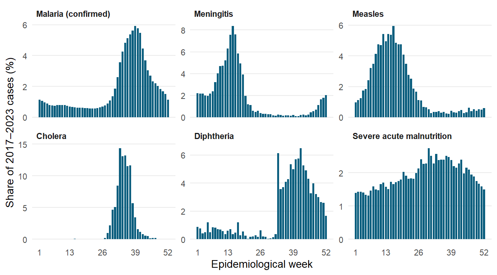

# Purpose and summary

This note sets out which econometric and statistical models suit Niger's weekly notifiable disease (MDO/IDSR) data, how to specify them, and in what order to apply them. The data are a panel of weekly case and death counts for 25 diseases in 72 health districts from 2015 to week 43 of 2024, with weekly reporting status for each district, maternal deaths for 2015–2021 and a DHIS2 extract for 2024.

Four features of the data drive every choice below (Section 2.2). The outcomes are **counts**; they are **heavily over-dispersed** (variance 27 to 2,600 times the mean); for epidemic-prone diseases **most district-weeks are zero** (80–99%); and counts are **strongly persistent and seasonal** (correlation with the previous week 0.78–0.94; 60–68% of malaria and meningitis cases fall in a 13-week season). Linear regression on raw or log counts is therefore not appropriate. The core family is the **negative binomial model with a population offset**, extended for zeros, dependence on past cases, space and interventions.

| Question | Recommended model | Section |
|------------------------------------------|------------------------------------------|---------|
| How do incidence levels, trends and seasonality differ across districts? What is associated with them? | Negative binomial panel model with district and time effects (Poisson PML as a robustness check) | 3 |
| How should rare, outbreak-driven diseases be modelled? | Zero-inflated or hurdle negative binomial | 4 |
| How much of the incidence of meningitis, measles, cholera or diphtheria comes from local persistence or from spread between districts? | Endemic–epidemic multivariate time-series model (hhh4) | 5 |
| How can weekly cases be forecast at national or regional level? | Count autoregression (INGARCH) and dynamic harmonic regression | 6 |
| How do rainfall, temperature or dust affect malaria and meningitis, and with what delay? | Distributed lag non-linear model (DLNM) | 7 |
| Which districts have persistently high risk once small-area noise is removed? | Bayesian spatio-temporal model (BYM2, INLA) | 8 |
| Did an intervention or shock change incidence? | Interrupted time series; difference-in-differences and event study | 9 |
| What explains late or missing reports, and differences in case fatality? | Panel logit, fractional logit, beta-binomial models | 10 |
| When should an alert be raised? | Farrington-type outbreak detection, CUSUM | 11 |

**Priorities.** Three models can be estimated with the data as they are and answer the most useful questions first: the negative binomial panel model (Section 3), the endemic–epidemic model for epidemic-prone diseases (Section 5) and outbreak detection (Section 11). Models that explain incidence with climate, conflict or programme variables (Sections 3.5, 7 and 9) need external data, listed in Section 3.5. The spatial models (Sections 5 and 8) need district boundaries (admin level 2), which are not yet in the project; only region boundaries (admin level 1) are.

# Data structure and notation

## Notation

| Symbol | Meaning |
|----------------|--------------------------------------------------|
| $i = 1, \dots, N$ | Health district ($N = 72$ from 2017; $N = 44$ when districts are harmonised to the pre-2017 boundaries, Section 2.3) |
| $r(i)$ | Region of district $i$ (8 regions) |
| $t = 1, \dots, T$ | Week, counted continuously from week 1 of 2015 |
| $a(t)$, $w(t)$ | Year and epidemiological week of the year of week $t$ |
| $y_{it}$ | Cases of the disease studied in district $i$, week $t$ |
| $d_{it}$ | Deaths from the disease |
| $P_{it}$ | Population of district $i$ in year $a(t)$, as listed in the weekly reports |
| $e_{it}$ | Exposure: $P_{it}/10^5$, so that rates are per 100,000 |
| $R_{it} \in \{T, L, N\}$ | Report status: on time, late, not received (2015–2023) |
| $\mathbf{x}_{it}$ | Covariates (external data, Section 3.5) |
| $\mu_{it}$ | Conditional mean of $y_{it}$ |

Throughout, $\mathbf{1}\{\cdot\}$ is the indicator function and $\Lambda(z) = e^z/(1+e^z)$ is the logistic function.

## Empirical features that guide model choice

Table 1 summarises district-week counts for the period with stable boundaries and complete years (2017–2023, 72 districts).

**Table 1.** District-week counts, 2017–2023 (malnutrition 2017–2021).

| Disease | Mean per district-week | Variance ÷ mean | Zero weeks | Lag-1 correlation | Peak week | Share in 13-week season |
|------------------------------|-----------:|-----------:|-----------:|-----------:|-----------:|-----------:|
| Malaria (confirmed) | 926 | 2,342 | 3.0% | 0.94 | 39 | 60% |
| Malaria (suspected) | 1,281 | 2,646 | 1.8% | 0.94 | 39 | 51% |
| Severe acute malnutrition | 90.2 | 168 | 4.6% | 0.86 | 30 | 31% |
| Measles | 1.74 | 39 | 80.2% | 0.83 | 16 | 63% |
| Meningitis | 0.50 | 27 | 89.3% | 0.80 | 15 | 68% |
| Cholera | 0.36 | 150 | 98.9% | 0.89 | 33 | 96% |
| Diphtheria | 0.16 | 43 | 98.1% | 0.79 | 42 | 64% |
| Pertussis | 0.13 | 33 | 98.0% | 0.23 | 9 | 53% |

*About 26,000 district-weeks per disease (18,792 for malnutrition). "Lag-1 correlation": correlation between $y_{it}$ and $y_{i,t-1}$ within districts. "Share in 13-week season": largest share of cases in any 13 consecutive weeks of the average year.*

{width=100%}

The implications are:

1. **Counts, not continuous outcomes.** Models must respect non-negativity and integer support; rates enter through an offset $\log\, e_{it}$.
2. **Over-dispersion.** A variance-to-mean ratio far above 1 rejects the Poisson variance assumption. Poisson point estimates remain consistent if the mean is correctly specified, but standard errors are too small. The negative binomial (NB) model is the default.
3. **Excess zeros.** For cholera, diphtheria and pertussis, nearly all district-weeks are zero and cases come in rare outbreaks. Zero-inflated or hurdle models (Section 4), or models with an autoregressive epidemic component (Section 5), are needed.
4. **Persistence.** Strong week-to-week correlation means observations are not independent: models need lagged counts, autoregressive errors or cluster-robust inference.
5. **Seasonality.** Malaria peaks in the rainy season (week 39), meningitis and measles in the dry season (weeks 15–16). Seasonality must be modelled explicitly (Fourier terms or week effects), and can differ between districts and diseases.
6. **Pertussis** shows little persistence (0.23): sporadic cases rather than sustained transmission, so a simple NB or hurdle model is enough.

## Data issues to handle before estimation

- **District reorganisation in 2017.** Several districts were split (44 districts before 2017, 72 after). For 2015–2024 analyses, aggregate the 72 districts to their 44 parent districts; for district-level inference at the finest level, restrict to 2017–2024.
- **Change of definition for confirmed malaria in 2021.** From 2015 to 2020 the series counts positive rapid tests or slides; from 2021 it counts confirmed cases, and malaria deaths move from the suspected to the confirmed series. Include a level-shift indicator $\mathbf{1}\{a(t) \geq 2021\}$ for confirmed malaria, or model test positivity for 2015–2020 separately (Section 10.3).
- **Partial year 2024.** The weekly reports stop at week 43. Never compare 2024 totals with full years; use weekly models or compare the same weeks.
- **Missing reports are not zeros.** When a district's report was not received ($R_{it} = N$), its count is unknown, not zero. Set $y_{it}$ to missing for those weeks. Sensitivity analyses can add the share of facilities reporting as a covariate where it is known (DHIS2, 2024).
- **Series that start or stop.** Malnutrition and maternal deaths end in 2021; COVID-19 starts in 2021 and dengue in 2023. Estimate each disease only over the years it is reported.
- **Suspected malaria in 2018** is incomplete (lower than confirmed malaria that year). Exclude 2018 from suspected-malaria models, or flag it with an indicator.
- **53-week years** (2015, 2020). Use a seasonal period of 52.18 weeks in Fourier terms, which handles them without special treatment.
- **Population denominators** are projections listed in the reports. Treat incidence rates as indicative; the offset can be replaced with WorldPop estimates as a robustness check.

# Panel count models for incidence

## Poisson pseudo-maximum likelihood with fixed effects

The baseline specification for district $i$ and week $t$ is

$$
\mathbb{E}\left[y_{it} \mid \mathbf{x}_{it}, \alpha_i, \tau_{a(t)}\right] = \mu_{it} = \exp\left(\log\, e_{it} + \alpha_i + \tau_{a(t)} + s\big(w(t)\big) + \mathbf{x}_{it}'\boldsymbol{\beta}\right) \qquad (1)
$$

where $\alpha_i$ are district fixed effects, $\tau_{a(t)}$ year fixed effects, $s(\cdot)$ a seasonal function (Section 3.4) and $\boldsymbol{\beta}$ the parameters of interest. $\exp(\beta_k)$ is an incidence rate ratio (IRR): the multiplicative change in expected incidence for a one-unit change in $x_k$.

Estimating (1) by Poisson pseudo-maximum likelihood (PPML) solves

$$
\sum_{i,t} \left(y_{it} - \mu_{it}\right) \mathbf{z}_{it} = \mathbf{0}, \qquad \mathbf{z}_{it} = \left(\mathbf{x}_{it}, \text{dummies}\right) \qquad (2)
$$

PPML is consistent whenever the conditional mean (1) is correct, whatever the true distribution of $y_{it}$, handles zeros naturally and has no incidental-parameters bias with district fixed effects (Santos Silva and Tenreyro, 2006). Standard errors must be cluster-robust by district. It is the recommended **robustness check** for every NB result.

## Negative binomial model

The NB2 model adds a dispersion parameter $\theta > 0$:

$$
y_{it} \mid \mu_{it} \sim \operatorname{NB}(\mu_{it}, \theta), \qquad \operatorname{Var}(y_{it} \mid \mu_{it}) = \mu_{it} + \frac{\mu_{it}^2}{\theta} \qquad (3)
$$

with $\mu_{it}$ given by (1). The probability mass function is

$$
\Pr(y_{it} = k) = \frac{\Gamma(k + \theta)}{\Gamma(\theta)\, k!} \left(\frac{\theta}{\theta + \mu_{it}}\right)^{\theta} \left(\frac{\mu_{it}}{\theta + \mu_{it}}\right)^{k}, \quad k = 0, 1, 2, \dots \qquad (4)
$$

As $\theta \to \infty$ the model reduces to Poisson. The dispersion can be allowed to differ by district or region, $\log\, \theta_i = \kappa_0 + \kappa_{r(i)}$.

**Testing for over-dispersion.** After a Poisson fit, the Cameron and Trivedi (1990) auxiliary regression

$$
\frac{\left(y_{it} - \hat{\mu}_{it}\right)^2 - y_{it}}{\hat{\mu}_{it}} = \delta\, \hat{\mu}_{it} + \varepsilon_{it} \qquad (5)
$$

tests $H_0: \delta = 0$ (Poisson) against $\delta > 0$ (NB2). Given Table 1, rejection is expected for every disease.

## Fixed or random district effects

With many weeks per district ($T \approx 500$), district fixed effects in NB models have negligible incidental-parameter bias, so (1) with dummies is appropriate. A random-effects alternative is

$$
\log\, \mu_{it} = \log\, e_{it} + \beta_0 + u_i + \tau_{a(t)} + s\big(w(t)\big) + \mathbf{x}_{it}'\boldsymbol{\beta}, \qquad u_i \sim \mathcal{N}(0, \sigma_u^2) \qquad (6)
$$

which allows district-level covariates and partial pooling. Because $u_i$ may be correlated with $\mathbf{x}_{it}$, use the Mundlak (1978) device: add district means $\bar{\mathbf{x}}_i$ as regressors, $u_i = \bar{\mathbf{x}}_i'\boldsymbol{\pi} + a_i$. A Wald test of $\boldsymbol{\pi} = \mathbf{0}$ is a robust Hausman-type test between fixed and random effects. Region-level random effects, $u_i = v_{r(i)} + a_i$, give a three-level model.

## Seasonality and trends

Seasonality is modelled with $K$ pairs of Fourier terms:

$$
s\big(w(t)\big) = \sum_{k=1}^{K} \left[\gamma_k \sin\left(\frac{2\pi k\, w(t)}{52.18}\right) + \delta_k \cos\left(\frac{2\pi k\, w(t)}{52.18}\right)\right] \qquad (7)
$$

$K = 1$ gives one smooth annual peak, and $K = 2$ or 3 allows asymmetric seasons such as malaria's sharp rise and slow decline. Choose $K$ by AIC/BIC. Seasonal amplitude and timing can vary by region through interactions $\gamma_{k,r(i)}$, $\delta_{k,r(i)}$. The peak week implied by $K = 1$ is $w^\ast = \tfrac{52.18}{2\pi}\operatorname{atan2}(\gamma_1, \delta_1)$, and the peak-to-trough rate ratio is $\exp\big(2\sqrt{\gamma_1^2 + \delta_1^2}\big)$.

Year effects $\tau_{a(t)}$ absorb national shocks. To estimate a trend, replace them with a linear or spline trend $f(t)$; a break in level for confirmed malaria in 2021 enters as $\eta\,\mathbf{1}\{a(t) \geq 2021\}$.

## Covariates and external data

The surveillance data contain no explanatory variables beyond place, time and population. Questions about determinants need external data, merged at district-week (or district-month) level:

| Variable | Relevance | Source |
|----------------------|------------------------------|------------------------------|
| Rainfall | Malaria vector breeding; cholera | CHIRPS (Climate Hazards Center) |
| Temperature, relative humidity | Malaria; meningitis (dry, hot season) | ERA5 reanalysis (Copernicus) |
| Dust (aerosol optical depth) | Meningitis (Harmattan dust) | MERRA-2 (NASA) |
| Vegetation (NDVI) | Malaria; food security | MODIS (NASA) |
| Vaccination coverage, campaigns | Measles, meningitis, diphtheria, pertussis | WHO/UNICEF estimates (WUENIC); national immunisation programme |
| Seasonal malaria chemoprevention (SMC) | Malaria | National malaria programme |
| Armed conflict events | Access to care, reporting | ACLED |
| Displacement | Crowding, outbreaks | IOM Displacement Tracking Matrix |
| Population | Denominators | WorldPop |
| District boundaries (admin 2) | Spatial models | OCHA Common Operational Datasets (HDX) |

Climate covariates act with delays, so they enter as lags $x_{i,t-\ell}$ (Section 7). Conflict and displacement affect both incidence and reporting, so models using them should also control for reporting status.

## Inference

Counts in the same district are serially correlated, and districts hit by the same epidemic are correlated with each other. Use standard errors clustered by district; with only 72 clusters, wild cluster bootstrap p-values are a useful check. Where cross-sectional dependence is strong (national epidemics), Driscoll and Kraay (1998) standard errors, which are robust to both serial and spatial correlation, are preferable. Including the lagged count $\log(1 + y_{i,t-1})$ captures persistence directly, at the cost of a dynamic-panel (Nickell-type) bias that is small when $T$ is large, as here.

# Models for excess zeros

For diseases where most district-weeks are zero (cholera, diphtheria, pertussis, and meningitis outside the season), two extensions of the NB model are available.

**Zero-inflated NB (ZINB).** Zeros come from two sources: a structural zero with probability $\pi_{it}$ (no transmission possible, e.g. no circulation of the pathogen), or a zero count from the NB process:

$$
\Pr(y_{it} = 0) = \pi_{it} + (1 - \pi_{it}) f_{\mathrm{NB}}(0 \mid \mu_{it}, \theta), \qquad \Pr(y_{it} = k) = (1 - \pi_{it}) f_{\mathrm{NB}}(k \mid \mu_{it}, \theta), \ k \geq 1 \qquad (8)
$$

$$
\operatorname{logit}(\pi_{it}) = \mathbf{z}_{it}'\boldsymbol{\gamma}, \qquad \log\, \mu_{it} = \log\, e_{it} + \mathbf{x}_{it}'\boldsymbol{\beta} \qquad (9)
$$

**Hurdle NB.** One process decides whether any case occurs, a second how many given at least one:

$$
\Pr(y_{it} = 0) = 1 - p_{it}, \qquad \Pr(y_{it} = k) = p_{it}\, \frac{f_{\mathrm{NB}}(k \mid \mu_{it}, \theta)}{1 - f_{\mathrm{NB}}(0 \mid \mu_{it}, \theta)}, \ k \geq 1, \qquad \operatorname{logit}(p_{it}) = \mathbf{z}_{it}'\boldsymbol{\gamma} \qquad (10)
$$

The hurdle model fits outbreak data well: the first part models **whether an outbreak is under way** (with lagged cases in the district and in neighbours in $\mathbf{z}_{it}$), the second **its size**. Compare NB, ZINB and hurdle by AIC/BIC and proper scoring rules (Section 12). The Vuong test is often used but is not valid for comparing nested zero-inflated models (Wilson, 2015).

# Endemic–epidemic model for epidemic-prone diseases

## Specification

The endemic–epidemic ("HHH") model of Held, Höhle and Hofmann (2005), extended by Paul and Held (2011) and Meyer and Held (2014), is the recommended model for meningitis, measles, cholera and diphtheria. It splits each week's expected cases into an endemic part and an epidemic part driven by last week's cases in the same district and in neighbouring districts:

$$
y_{it} \mid \mathbf{y}_{t-1} \sim \operatorname{NB}\left(\mu_{it}, \psi_i\right) \qquad (11)
$$

$$
\mu_{it} = \underbrace{e_{it}\, \nu_{it}}_{\text{endemic}} + \underbrace{\lambda_{it}\, y_{i,t-1}}_{\text{within district}} + \underbrace{\phi_{it} \sum_{j \neq i} w_{ji}\, y_{j,t-1}}_{\text{from neighbours}} \qquad (12)
$$

Each component has a log-linear predictor:

$$
\log\, \nu_{it} = \alpha_i^{(\nu)} + \beta^{(\nu)} t + \sum_{k=1}^{K} \left[\gamma_k^{(\nu)} \sin(\omega_k t) + \delta_k^{(\nu)} \cos(\omega_k t)\right] + \mathbf{x}_{it}'\boldsymbol{\beta}^{(\nu)} \qquad (13)
$$

$$
\log\, \lambda_{it} = \alpha_i^{(\lambda)} + \sum_{k=1}^{K} \left[\gamma_k^{(\lambda)} \sin(\omega_k t) + \delta_k^{(\lambda)} \cos(\omega_k t)\right], \qquad \log\, \phi_{it} = \alpha_i^{(\phi)} + \mathbf{x}_{it}'\boldsymbol{\beta}^{(\phi)} \qquad (14)
$$

with $\omega_k = 2\pi k / 52.18$. District intercepts can be fixed or random, $\alpha_i^{(\cdot)} \sim \mathcal{N}(\alpha^{(\cdot)}, \sigma_{(\cdot)}^2)$. Seasonality in the epidemic component $\lambda_{it}$ captures seasonal transmission (dry-season meningitis), not only seasonal background incidence.

## Spatial weights

Spread between districts uses a power law in the adjacency order $o_{ji}$ (1 for districts sharing a border, 2 for neighbours of neighbours, and so on), with the decay $\rho$ estimated from the data:

$$
w_{ji} = \frac{o_{ji}^{-\rho}}{\sum_{k \neq j} o_{jk}^{-\rho}}, \qquad j \neq i \qquad (15)
$$

The adjacency orders require district polygons (admin level 2). Population or mobility (e.g. road distance, population gravity $P_i^{\zeta}$) can be added to the weights.

## Interpretation

- The **share of expected cases from each component**, $e_{it}\nu_{it}/\mu_{it}$, $\lambda_{it} y_{i,t-1}/\mu_{it}$ and $\phi_{it}\sum_j w_{ji} y_{j,t-1}/\mu_{it}$, shows whether a disease is mainly sporadic (endemic) or transmitted locally or from neighbours.
- The **epidemic proportion** is summarised by the dominant eigenvalue of $\boldsymbol{\Lambda}_t = \operatorname{diag}(\boldsymbol{\lambda}_t) + \operatorname{diag}(\boldsymbol{\phi}_t)\mathbf{W}'$. A value above 1 means cases would grow without the endemic input, analogous to a reproduction number above 1 at the weekly time scale.
- **Covariates** enter where they act: vaccination coverage in $\lambda$ and $\phi$ (susceptibility), climate in $\nu$ and $\lambda$, conflict and displacement in $\phi$ (mobility).
- The model produces **one-step and multi-step probabilistic forecasts**, evaluated by proper scoring rules (Section 12), which makes it suitable for early warning.

It is estimated by maximum likelihood (penalised likelihood for random effects) with the `hhh4()` function of the R package `surveillance`.

# Time-series models for national and regional series

For national or regional weekly totals (one or a few long series), two families are appropriate.

**Count autoregression (log-linear INGARCH).** Following Fokianos and Tjøstheim (2011):

$$
y_t \mid \mathcal{F}_{t-1} \sim \operatorname{NB}(\lambda_t, \theta), \qquad \nu_t = \log\, \lambda_t = \omega + \sum_{k=1}^{p} \alpha_k \log(1 + y_{t-k}) + \sum_{l=1}^{q} \beta_l\, \nu_{t-l} + \mathbf{x}_t'\boldsymbol{\eta} \qquad (16)
$$

where $\mathcal{F}_{t-1}$ is the history up to week $t-1$. Lags $k = 1$ and $k = 52$ capture short-term persistence and annual recurrence; Fourier terms (7) can be added to $\mathbf{x}_t$. Estimated with the R package `tscount`.

**Dynamic harmonic regression** (regression with ARIMA errors) on $z_t = \log(1 + y_t)$:

$$
z_t = \beta_0 + \sum_{k=1}^{K} \left[\gamma_k \sin(\omega_k t) + \delta_k \cos(\omega_k t)\right] + \mathbf{x}_t'\boldsymbol{\beta} + \eta_t, \qquad \phi(B)(1 - B)^{d}\, \eta_t = \vartheta(B)\, \varepsilon_t \qquad (17)
$$

where $B$ is the backshift operator ($B\eta_t = \eta_{t-1}$) and $\varepsilon_t$ is white noise. Fourier terms handle the 52.18-week season better than a seasonal ARIMA with period 52. Suitable for high-count series (malaria, malnutrition); for low counts use (16).

# Climate and lagged effects: distributed lag non-linear models

Climate affects malaria and meningitis non-linearly and with delays (rainfall raises malaria incidence several weeks later; low humidity and dust raise meningitis risk). The distributed lag non-linear model (Gasparrini, Armstrong and Kenward, 2010) estimates the exposure–lag–response surface:

$$
\log\, \mu_{it} = \log\, e_{it} + \alpha_i + s\big(w(t)\big) + f(t) + \sum_{\ell=0}^{L} g\left(x_{i,t-\ell}, \ell\right) \qquad (18)
$$

$$
g(x, \ell) = \sum_{j=1}^{J} \sum_{m=1}^{M} \eta_{jm}\, b_j(x)\, c_m(\ell) \qquad (19)
$$

where $b_j(\cdot)$ are basis functions for the exposure (e.g. natural splines of rainfall) and $c_m(\cdot)$ for the lag ($L = 12$ weeks for rainfall and malaria). The relative risk at exposure $x$ and lag $\ell$, against a reference $x_0$, is $\operatorname{RR}(x, \ell) = \exp\{g(x, \ell) - g(x_0, \ell)\}$; the cumulative relative risk is $\exp \sum_{\ell} \{g(x,\ell) - g(x_0,\ell)\}$. The model is estimated by NB or quasi-Poisson regression with the R package `dlnm`. Seasonal terms must be kept flexible enough not to absorb the climate signal, but not so flexible that they remove it; sensitivity to $K$ should be reported.

# Bayesian spatio-temporal disease mapping

District rates from small counts are noisy. Bayesian hierarchical models borrow strength from neighbouring districts and adjacent periods to estimate stable relative risks. With yearly (or monthly) counts $y_{ia}$:

$$
y_{ia} \sim \operatorname{Poisson}\left(E_{ia}\, \theta_{ia}\right), \qquad E_{ia} = P_{ia} \frac{\sum_{i,a} y_{ia}}{\sum_{i,a} P_{ia}} \qquad (20)
$$

where $E_{ia}$ are expected counts and $\theta_{ia}$ the relative risk (a NB likelihood can replace the Poisson). The linear predictor is

$$
\log\, \theta_{ia} = \beta_0 + \mathbf{x}_{ia}'\boldsymbol{\beta} + b_i + \gamma_a + \delta_{ia} \qquad (21)
$$

The spatial effect follows the Besag–York–Mollié model (Besag, York and Mollié, 1991) in its BYM2 parameterisation (Riebler et al., 2016):

$$
b_i = \sigma_b \left(\sqrt{1 - \varphi}\, v_i + \sqrt{\varphi}\, u_i^{\ast}\right), \qquad v_i \sim \mathcal{N}(0, 1) \qquad (22)
$$

where $u_i^{\ast}$ is an intrinsic conditional autoregressive (ICAR) effect scaled to unit variance,

$$
u_i \mid \mathbf{u}_{-i} \sim \mathcal{N}\left(\frac{1}{n_i} \sum_{j \sim i} u_j,\ \frac{1}{n_i \tau_u}\right) \qquad (23)
$$

with $j \sim i$ denoting districts sharing a border and $n_i$ the number of neighbours. $\varphi \in [0, 1]$ is the share of spatial variance that is spatially structured. The temporal effect $\gamma_a$ is a second-order random walk, $\gamma_a - 2\gamma_{a-1} + \gamma_{a-2} \sim \mathcal{N}(0, \sigma_\gamma^2)$, and $\delta_{ia}$ a space–time interaction (Knorr-Held, 2000, types I–IV) that lets district trends differ.

The main outputs are posterior relative risks $\theta_{ia}$ and **exceedance probabilities** $\Pr(\theta_{ia} > c \mid \mathbf{y})$, e.g. the probability that a district's risk is at least 50% above the national average ($c = 1.5$), which are robust to small numbers. Estimation uses integrated nested Laplace approximations (R-INLA; Rue, Martino and Chopin, 2009). The 8 regions are too few for spatial smoothing, so district boundaries (admin level 2) are required.

# Evaluating interventions and shocks

## Interrupted time series

To estimate the effect of an event at week $T_0$ (a vaccination campaign, the start of seasonal malaria chemoprevention, COVID-19 disruptions in 2020), segmented NB regression on the affected series:

$$
\log\, \mu_t = \log\, e_t + \beta_0 + \beta_1 t + \beta_2 D_t + \beta_3 (t - T_0) D_t + s\big(w(t)\big) + \mathbf{x}_t'\boldsymbol{\gamma}, \qquad D_t = \mathbf{1}\{t \geq T_0\} \qquad (24)
$$

$\exp(\beta_2)$ is the immediate change in level and $\exp(\beta_3)$ the change in weekly trend. The counterfactual is the prediction with $D_t = 0$. Residual autocorrelation must be checked and modelled (Bernal, Cummins and Gasparrini, 2017). A control series not affected by the intervention (another disease, or untreated districts) strengthens the design.

## Difference-in-differences and event study

When an intervention reaches districts at different times (staggered adoption), with $G_i$ the first week of treatment in district $i$:

$$
\log\, \mu_{it} = \log\, e_{it} + \alpha_i + \gamma_t + \sum_{k = -K,\ k \neq -1}^{L} \theta_k\, \mathbf{1}\{t - G_i = k\} + \mathbf{x}_{it}'\boldsymbol{\beta} \qquad (25)
$$

estimated by PPML with district and week fixed effects. $\exp(\theta_k)$ for $k \geq 0$ traces the effect $k$ weeks after adoption; $\theta_k$ for $k < 0$ test for pre-existing trends. With staggered timing and heterogeneous effects, the two-way fixed-effects estimator can be biased; use heterogeneity-robust estimators (Callaway and Sant'Anna, 2021; Sun and Abraham, 2021), which compare each adoption cohort only with not-yet-treated districts. For an intervention in a single region, the synthetic control method (Abadie, Diamond and Hainmueller, 2010) builds a weighted combination of other regions as the counterfactual.

**Identification.** These designs require that treated and comparison districts would have followed parallel paths without the intervention. Interventions in Niger are often targeted at high-burden districts, so the pre-trend coefficients and placebo tests must be reported.

# Reporting performance and case fatality

## Timeliness of reports

For the weekly report status of each district (2015–2023), a binary panel model for on-time reporting, $T_{it} = \mathbf{1}\{R_{it} = T\}$:

$$
\Pr(T_{it} = 1 \mid \mathbf{x}_{it}, u_i) = \Lambda\left(\alpha + u_i + \tau_{a(t)} + s\big(w(t)\big) + \mathbf{x}_{it}'\boldsymbol{\beta}\right) \qquad (26)
$$

with random district effects $u_i \sim \mathcal{N}(0, \sigma_u^2)$, or district fixed effects by conditional (Chamberlain) logit. Because the three statuses are ordered (not received < late < on time), an ordered logit is a natural extension:

$$
\Pr(R_{it} \leq m) = \Lambda\left(\kappa_m - \mathbf{x}_{it}'\boldsymbol{\beta} - u_i\right), \qquad m \in \{N, L\} \qquad (27)
$$

Relevant covariates include conflict events, distance to the regional capital, rainy season (road access) and staffing.

## Completeness as a proportion

The 2024 completeness and timeliness are percentages $c_i \in [0, 1]$, including values of exactly 0 and 1. The fractional logit of Papke and Wooldridge (1996) models the mean directly,

$$
\mathbb{E}[c_i \mid \mathbf{x}_i] = \Lambda(\mathbf{x}_i'\boldsymbol{\beta}) \qquad (28)
$$

estimated by Bernoulli quasi-maximum likelihood with robust standard errors. For weekly DHIS2 facility completeness, add district and week effects.

## Case fatality and test positivity

Case fatality is modelled on aggregated counts, because deaths are not always reported in the same week as the cases. For district $i$ and year $a$, with $n_{ia}$ cases and $d_{ia}$ deaths:

$$
d_{ia} \mid n_{ia}, p_{ia} \sim \operatorname{Binomial}(n_{ia}, p_{ia}), \qquad p_{ia} \sim \operatorname{Beta}\left(\pi_{ia}\frac{1-\rho}{\rho},\ (1 - \pi_{ia})\frac{1-\rho}{\rho}\right) \qquad (29)
$$

$$
\operatorname{logit}(\pi_{ia}) = \alpha + u_i + \tau_a + \mathbf{x}_{ia}'\boldsymbol{\beta} \qquad (30)
$$

The beta-binomial allows over-dispersion through the intra-class correlation $\rho$. The same model applies to the **share of maternal deaths investigated** (2016–2021) and to **malaria test positivity** in 2015–2020 (positives out of tests done), a useful indicator that is not affected by the 2021 change of definition.

# Outbreak detection and early warning

For routine surveillance, the aim is to flag weeks with more cases than expected. The improved Farrington algorithm (Farrington et al., 1996; Noufaily et al., 2013) fits, for each week $t_0$, a quasi-Poisson model to the same period of the previous $b$ years:

$$
\log\, \mu_t = \alpha + \beta t + \sum_{q=1}^{Q} \zeta_q\, \mathbf{1}\{t \in \mathcal{S}_q\}, \qquad \operatorname{Var}(y_t) = \phi\, \mu_t \qquad (31)
$$

where $\mathcal{S}_q$ are seasonal periods of the reference years and past outbreak weeks are down-weighted. An alarm is raised when $y_{t_0} > U_{t_0}$, the upper $1 - \alpha$ quantile of a NB distribution with mean $\hat{\mu}_{t_0}$ and variance $\hat{\phi}\hat{\mu}_{t_0}$.

A complementary CUSUM statistic accumulates moderate excesses that individual weeks would miss:

$$
S_t = \max\left(0,\ S_{t-1} + \frac{y_t - \hat{\mu}_t}{\hat{\sigma}_t} - k\right), \qquad \text{alarm if } S_t > h \qquad (32)
$$

For meningitis, these statistical alarms complement the WHO alert (3 cases per 100,000 per week) and epidemic (10 per 100,000) thresholds already computed in the dashboard. The algorithms are implemented in the R package `surveillance` (`farringtonFlexible`, `glrnb`).

# Model selection, diagnostics and validation

- **Information criteria.** AIC and BIC for nested and non-nested likelihood models; likelihood-ratio tests for nested ones (e.g. NB against Poisson, with the boundary correction for $\theta$).
- **Residuals.** Randomised quantile residuals (Dunn and Smyth, 1996) are approximately normal for count models and reveal misspecification that Pearson residuals hide. Check residual autocorrelation (Ljung–Box test) and spatial autocorrelation (Moran's I on district residuals).
- **Calibration.** Probability integral transform (PIT) histograms should be flat for well-calibrated predictive distributions.
- **Proper scoring rules** (Gneiting and Raftery, 2007) for comparing forecasts: the logarithmic score $\operatorname{LS} = -\log\, f(y_t)$, the Dawid–Sebastiani score $\operatorname{DSS} = \big((y_t - \mu_t)/\sigma_t\big)^2 + 2\log\, \sigma_t$, and the ranked probability score.
- **Out-of-sample validation.** Rolling-origin evaluation: fit on data up to year $a$, forecast 1 to 4 weeks ahead through year $a + 1$, and roll forward. Report scores by disease and horizon.
- **Sensitivity analyses.** (i) 44 harmonised districts for 2015–2024 against 72 districts for 2017–2024; (ii) with and without 2024; (iii) missing reports treated as missing rather than zero; (iv) alternative population denominators (WorldPop); (v) confirmed malaria before and after the 2021 definition change, analysed separately.

# Implementation

All models can be estimated in the project's `mdo-niger` conda environment after adding the R packages below (from conda-forge where available, otherwise CRAN).

| Model | R | Python |
|------------------------------|------------------------------|--------------------------|
| PPML and NB with fixed effects | `fixest` (`fepois`, `fenegbin`) | `statsmodels`, `pyfixest` |
| NB with random effects, zero-inflated, hurdle | `glmmTMB`, `pscl` | `statsmodels` |
| Endemic–epidemic model | `surveillance` (`hhh4`) | – |
| Count autoregression | `tscount` | – |
| Dynamic harmonic regression | `fable`, `forecast` | `statsmodels` (`SARIMAX`) |
| Distributed lag non-linear model | `dlnm` | – |
| BYM2 spatio-temporal model | `INLA` | – |
| Staggered difference-in-differences | `did`, `fixest` (`sunab`) | `differences` |
| Ordered and fractional logit | `ordinal`, `glm` (quasibinomial) | `statsmodels` |
| Outbreak detection | `surveillance` | – |

The processed tables already provide the estimation samples: `mdo_long.csv` (district-week counts and populations), `completeness_weekly.csv` (report status), `maternal_deaths.csv` and `dhis2_2024_weekly.csv`; see `docs/data_dictionary.md`.

**Suggested sequence.**

1. *Descriptive models with the existing data:* NB panel models with Fourier seasonality and year effects for each major disease (Section 3), with PPML as a check; hurdle models for rare diseases (Section 4); outbreak detection (Section 11); reporting-performance models (Section 10.1).
2. *Spatial dynamics:* obtain district boundaries (admin 2) and estimate the endemic–epidemic model for meningitis, measles, cholera and diphtheria (Section 5) and BYM2 risk maps (Section 8).
3. *Determinants and evaluation:* merge climate, vaccination, SMC and conflict data; estimate DLNMs (Section 7) and intervention models (Section 9).

# References

Abadie, A., Diamond, A. and Hainmueller, J. (2010). Synthetic control methods for comparative case studies. *Journal of the American Statistical Association*, 105(490), 493–505.

Bernal, J. L., Cummins, S. and Gasparrini, A. (2017). Interrupted time series regression for the evaluation of public health interventions: a tutorial. *International Journal of Epidemiology*, 46(1), 348–355.

Besag, J., York, J. and Mollié, A. (1991). Bayesian image restoration, with two applications in spatial statistics. *Annals of the Institute of Statistical Mathematics*, 43(1), 1–20.

Callaway, B. and Sant'Anna, P. H. C. (2021). Difference-in-differences with multiple time periods. *Journal of Econometrics*, 225(2), 200–230.

Cameron, A. C. and Trivedi, P. K. (1990). Regression-based tests for overdispersion in the Poisson model. *Journal of Econometrics*, 46(3), 347–364.

Cameron, A. C. and Trivedi, P. K. (2013). *Regression Analysis of Count Data* (2nd ed.). Cambridge University Press.

Driscoll, J. C. and Kraay, A. C. (1998). Consistent covariance matrix estimation with spatially dependent panel data. *Review of Economics and Statistics*, 80(4), 549–560.

Dunn, P. K. and Smyth, G. K. (1996). Randomized quantile residuals. *Journal of Computational and Graphical Statistics*, 5(3), 236–244.

Farrington, C. P., Andrews, N. J., Beale, A. D. and Catchpole, M. A. (1996). A statistical algorithm for the early detection of outbreaks of infectious disease. *Journal of the Royal Statistical Society, Series A*, 159(3), 547–563.

Fokianos, K. and Tjøstheim, D. (2011). Log-linear Poisson autoregression. *Journal of Multivariate Analysis*, 102(3), 563–578.

Gasparrini, A., Armstrong, B. and Kenward, M. G. (2010). Distributed lag non-linear models. *Statistics in Medicine*, 29(21), 2224–2234.

Gneiting, T. and Raftery, A. E. (2007). Strictly proper scoring rules, prediction, and estimation. *Journal of the American Statistical Association*, 102(477), 359–378.

Held, L., Höhle, M. and Hofmann, M. (2005). A statistical framework for the analysis of multivariate infectious disease surveillance counts. *Statistical Modelling*, 5(3), 187–199.

Knorr-Held, L. (2000). Bayesian modelling of inseparable space-time variation in disease risk. *Statistics in Medicine*, 19(17–18), 2555–2567.

Meyer, S. and Held, L. (2014). Power-law models for infectious disease spread. *Annals of Applied Statistics*, 8(3), 1612–1639.

Mundlak, Y. (1978). On the pooling of time series and cross section data. *Econometrica*, 46(1), 69–85.

Noufaily, A., Enki, D. G., Farrington, P., Garthwaite, P., Andrews, N. and Charlett, A. (2013). An improved algorithm for outbreak detection in multiple surveillance systems. *Statistics in Medicine*, 32(7), 1206–1222.

Papke, L. E. and Wooldridge, J. M. (1996). Econometric methods for fractional response variables with an application to 401(k) plan participation rates. *Journal of Applied Econometrics*, 11(6), 619–632.

Paul, M. and Held, L. (2011). Predictive assessment of a non-linear random effects model for multivariate time series of infectious disease counts. *Statistics in Medicine*, 30(10), 1118–1136.

Riebler, A., Sørbye, S. H., Simpson, D. and Rue, H. (2016). An intuitive Bayesian spatial model for disease mapping that accounts for scaling. *Statistical Methods in Medical Research*, 25(4), 1145–1165.

Rue, H., Martino, S. and Chopin, N. (2009). Approximate Bayesian inference for latent Gaussian models by using integrated nested Laplace approximations. *Journal of the Royal Statistical Society, Series B*, 71(2), 319–392.

Santos Silva, J. M. C. and Tenreyro, S. (2006). The log of gravity. *Review of Economics and Statistics*, 88(4), 641–658.

Sun, L. and Abraham, S. (2021). Estimating dynamic treatment effects in event studies with heterogeneous treatment effects. *Journal of Econometrics*, 225(2), 175–199.

Wilson, P. (2015). The misuse of the Vuong test for non-nested models to test for zero-inflation. *Economics Letters*, 127, 51–53.

World Health Organization (2014). Meningitis outbreak response in sub-Saharan Africa: WHO guideline. Geneva: WHO.
